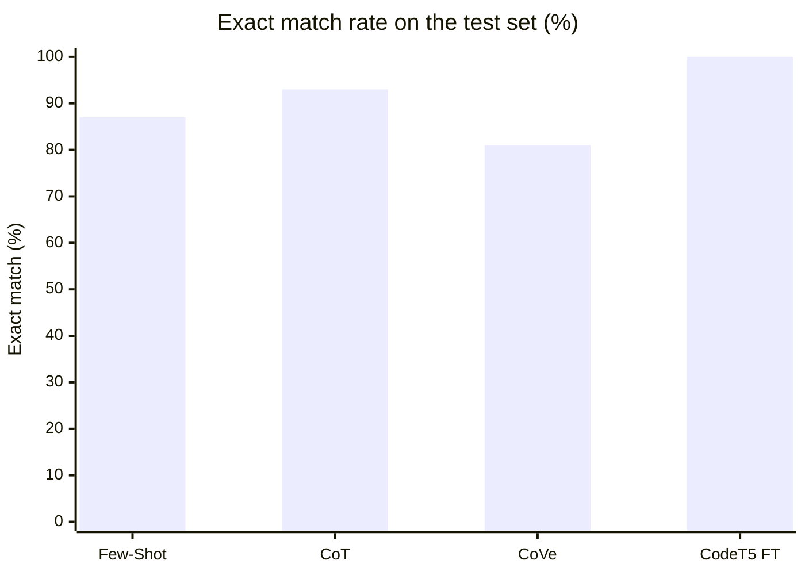
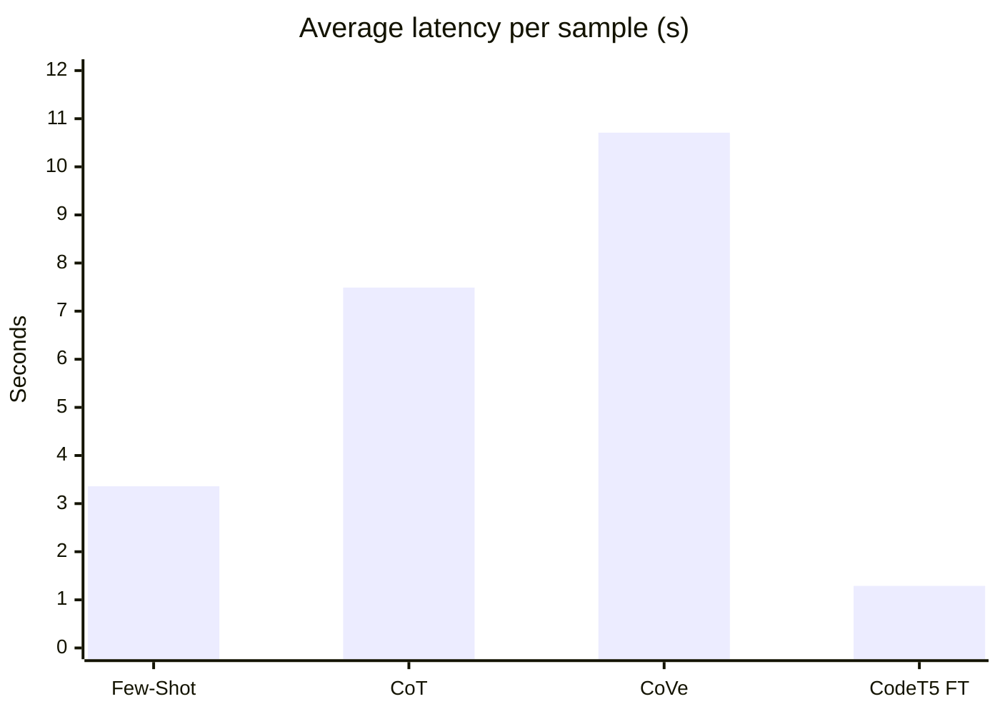
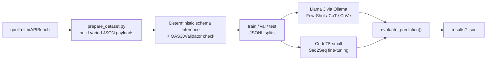
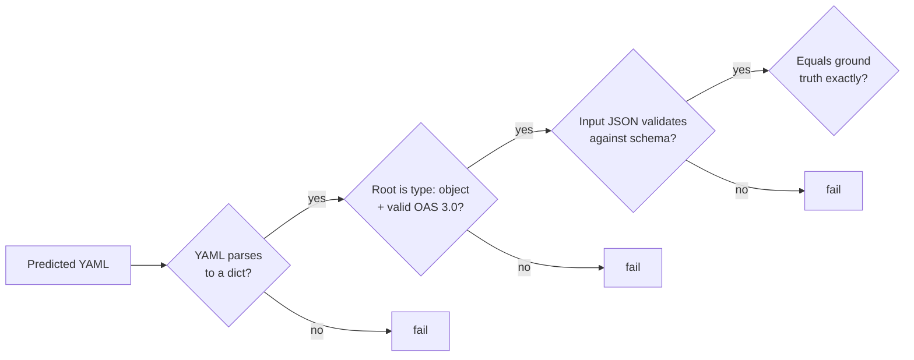

# json2openapi-llm

> Automatically turning raw **JSON payloads** into valid **OpenAPI 3.0 YAML Schema Objects**: comparing **prompt engineering on a general-purpose LLM** (Llama 3 via Ollama) with **fine-tuning a small code model** (CodeT5-small).


-orange)


---

## Table of Contents

- [The task](#the-task)
- [Results at a glance](#results-at-a-glance)
- [Pipeline](#pipeline)
- [Dataset](#dataset)
- [Approaches](#approaches)
- [Evaluation metrics](#evaluation-metrics)
- [Detailed results and error analysis](#detailed-results-and-error-analysis)
- [Out-of-distribution test](#out-of-distribution-test)
- [Project structure](#project-structure)
- [Getting started](#getting-started)
- [Key takeaways](#key-takeaways)

---

## The task

Given an arbitrary JSON response such as:

```json
{"status": "ok", "data": {"score": 0.59, "provider": "TensorFlow Hub", "arg_count": 1},
 "meta": {"version": 3, "cached": true}}
```

generate the matching OpenAPI 3.0 Schema Object:

```yaml
type: object
properties:
  status:
    type: string
  data:
    type: object
    properties:
      score:
        type: number
      provider:
        type: string
      arg_count:
        type: integer
  meta:
    type: object
    properties:
      version:
        type: integer
      cached:
        type: boolean
```

Type-mapping rules: `int → integer`, `float → number`, `bool → boolean`, `null → string + nullable: true`, `[] → array + items: {}`. Non-empty arrays take their item type from the first element, and objects are handled recursively.

---

## Results at a glance

Evaluated on the **same 100 held-out test samples** for every method.

| Method | YAML parse | OAS 3.0 valid | JSON validates | Exact match | Avg latency |
|---|:---:|:---:|:---:|:---:|:---:|
| Llama 3: Few-Shot | 91 % | 90 % | 89 % | 87 % | 3.36 s |
| Llama 3: Chain-of-Thought | **100 %** | **100 %** | 98 % | 93 % | 7.49 s |
| Llama 3: Chain-of-Verification | **100 %** | 99 % | 88 % | 81 % | 10.71 s |
| **CodeT5-small (fine-tuned)** | **100 %** | **100 %** | **100 %** | **100 %** | **1.29 s** |





> [!IMPORTANT]
> CodeT5 scores 100 % **in-distribution**, but generalizes poorly to JSON with structures it has never seen (only 1/5 exact match in the [out-of-distribution test](#out-of-distribution-test)). Llama 3 with CoT is the most robust choice for arbitrary input.

---

## Pipeline



---

## Dataset

Built by [`prepare_dataset.py`](prepare_dataset.py) from real API records in [`gorilla-llm/APIBench`](https://huggingface.co/datasets/gorilla-llm/APIBench):

1. For each APIBench record a **varied REST-like JSON payload** is built: 3–6 random fields from a pool (ids, names, booleans, floats, nulls, string arrays, ...) placed into one of four structures: `flat`, `nested_meta`, `nested_config` or `with_items` (an array of objects).
2. The ground-truth schema is generated **deterministically** by `infer_openapi_schema()`.
3. Each pair is kept only if the schema passes `OAS30Validator.check_schema` **and** the payload validates against it.
4. The data is split 80 / 10 / 10 with a fixed seed (`42`), and the test split is capped at 100 samples.

| Split | Samples |
|---|---:|
| Train | 12,174 |
| Validation | 1,522 |
| Test | 100 |

---

## Approaches

### 1. Prompt engineering: Llama 3 (8B) via Ollama

Implemented in [`evaluate_ollama.py`](evaluate_ollama.py). All runs use `temperature = 0.0`.

| Technique | Idea | LLM calls |
|---|---|:---:|
| **Few-Shot** | Rules plus two worked input→output examples, asks for raw YAML only | 1 |
| **Chain-of-Thought (CoT)** | Strict formatting rules, then "think step by step": list the keys and their types, check edge cases, and output the YAML in a fenced block | 1 |
| **Chain-of-Verification (CoVe)** | Generate a draft, then a second "schema auditor" prompt checks it against a 5-point checklist and fixes errors | 2 |

The model output is post-processed by `extract_yaml()`, which takes the last ```` ```yaml ```` fence or falls back to the last root-level `type: object`.

### 2. Fine-tuning: CodeT5-small

Implemented in [`colab_train_codet5.ipynb`](colab_train_codet5.ipynb) using Hugging Face `Seq2SeqTrainer`.

| Hyper-parameter | Value |
|---|---|
| Base model | `Salesforce/codet5-small` (~60M params) |
| Input prefix | `Generate OpenAPI 3.0 YAML schema: ` |
| Max source / target length | 384 / 384 tokens |
| Epochs | 3 |
| Learning rate | 3e-4 |
| Batch size (train / eval) | 16 / 32 |
| Weight decay | 0.01 |
| Decoding | beam search, `num_beams=2` |

**Training curve**

| Epoch | Step | Validation loss |
|:---:|:---:|:---:|
| 1 | 761 | 8.36e-06 |
| 2 | 1522 | 2.00e-05 |
| 3 | 2283 | **1.39e-06** |

The training loss drops from 0.45 (step 100) to below 0.01 by step 200. Total training time was about 15 min (902 s, 40.5 samples/s).

---

## Evaluation metrics

Every prediction goes through the same cascading check in `evaluate_prediction()`. Each level requires the one before it:



| Metric | Meaning |
|---|---|
| `yaml_parse_rate` | Output is syntactically valid YAML (a mapping) |
| `oas_schema_valid_rate` | Valid OpenAPI 3.0 Schema Object with root `type: object` + `properties` |
| `json_validation_accuracy` | The original JSON payload validates against the predicted schema, so the schema is *functionally correct* |
| `exact_match_rate` | Predicted schema is structurally identical to the ground truth |
| `avg_latency_s` | Mean wall-clock generation time per sample |

---

## Detailed results and error analysis

### Latency distribution

| Method | p50 | p95 | Total (100 samples) |
|---|:---:|:---:|:---:|
| Few-Shot | 2.54 s | 4.27 s | 337 s |
| CoT | 7.24 s | 12.07 s | 749 s |
| CoVe | 10.47 s | 14.11 s | 1072 s |
| CodeT5 FT | 1.26 s | 2.19 s | 129 s |

### Where the LLM techniques fail

| Technique | Failures | Dominant failure mode |
|---|:---:|---|
| **Few-Shot** | 13 | **10/13 are broken YAML syntax**: the model writes `items: type: string` on one line, which is invalid YAML. The rest are one integer/number confusion and minor schema differences |
| **CoT** | 7 | 5 outputs are functionally valid but differ slightly from the ground truth. Only 2 have real type errors (e.g. `boolean` typed as `string`) |
| **CoVe** | 19 | The **verification step introduces errors**: in 8 cases the auditor re-typed `cached` / `active` booleans as `string`. It also turned floats into `integer` (3) and dropped `nullable` (1) |

> [!NOTE]
> The explicit "think step by step" plus strict formatting rules in CoT removes the YAML syntax errors seen in Few-Shot. The extra self-verification pass in CoVe actually **hurts** accuracy: the 8B model "over-corrects" drafts that were already correct, and the extra call adds about 3 s of latency.

---

## Out-of-distribution test

To check generalization, the fine-tuned CodeT5 was given 5 hand-written JSON payloads whose keys and structures do **not** occur in the training data (e-commerce order, medical record, geo-coordinates, bank transaction, IoT sensor).

| # | Input (abridged) | YAML | OAS | JSON valid | Exact |
|:-:|---|:-:|:-:|:-:|:-:|
| 1 | `{"order_id", "total_eur", "paid", "coupon": null, "items": [{...}]}` | ❌ | ❌ | ❌ | ❌ |
| 2 | `{"patient": {...}, "allergies": [], "visits"}` | ✅ | ✅ | ❌ | ❌ |
| 3 | `{"coords": {"lat", "lon"}, "city", "alerts": [...]}` | ✅ | ❌ | ❌ | ❌ |
| 4 | `{"tx_id", "amount", "currency", "approved", "meta": {...}}` | ✅ | ✅ | ✅ | ✅ |
| 5 | `{"sensor", "readings": [{...}], "notes": null, "errors": []}` | ❌ | ❌ | ❌ | ❌ |

**Result: 1/5 exact match.** Typical errors:

- **Broken indentation**, which makes the YAML invalid.
- **Hallucinated keys from the training distribution**: `items[].name` instead of `sku`/`qty`, and an invented `id` field.
- **Flattened nested objects**: `patient` typed as `string`.
- **Truncated key names**: `smoker → smok`.
- **Missed `nullable: true`** for `null` values.

> [!WARNING]
> CodeT5 has memorized the *template distribution* of the synthetic dataset rather than learning the general JSON→schema mapping. Its 100 % test score reflects how similar the test split is to the training data, not real-world robustness.

---

## Project structure

```
json2openapi-llm/
├── prepare_dataset.py            # APIBench → varied JSON payloads → (json, yaml) pairs
├── evaluate_ollama.py            # Few-Shot / CoT / CoVe prompts + shared evaluate_prediction()
├── test_ollama.py                # Quick single-sample sanity check against Ollama
├── colab_evaluate_ollama.ipynb   # Colab: install Ollama, pull llama3, run the full evaluation
├── colab_train_codet5.ipynb      # Colab: fine-tune CodeT5-small, evaluate, OOD test
├── requirements.txt
├── data/                         # generated (git-ignored)
│   ├── train.jsonl
│   ├── val.jsonl
│   └── test.jsonl
└── results/                      # generated (git-ignored)
    ├── ollama_{few_shot,cot,cove}.json
    ├── ollama_summary.json
    ├── transformer_codet5.json
    ├── codet5_training_log.json
    └── codet5_ood_test.json
```

---

## Getting started

### Local setup

```bash
git clone https://github.com/Dobrosav/json2openapi-llm.git
cd json2openapi-llm
python -m venv venv && source venv/bin/activate
pip install -r requirements.txt

# 1. Build the dataset
python prepare_dataset.py
```

### Prompt-engineering evaluation (Ollama)

```bash
# Requires a running Ollama server: https://ollama.com
ollama pull llama3
python evaluate_ollama.py --limit 100
```

Alternatively, open [`colab_evaluate_ollama.ipynb`](colab_evaluate_ollama.ipynb) in Google Colab, choose a **T4 GPU** runtime and click *Run all*.

### Fine-tuning CodeT5 (Google Colab)

Open [`colab_train_codet5.ipynb`](colab_train_codet5.ipynb) in Colab with a GPU runtime and run all cells. The notebook clones the repo, builds the dataset, trains, evaluates on the test set, runs the OOD test and can copy the results to Google Drive.

> [!TIP]
> The notebook pins `transformers>=4.46,<5`. Transformers 5.x fails to load the CodeT5 tokenizer (`TypeError: Input must be a List[Union[str, AddedToken]]`). If Colab already loaded a different version, use **Runtime → Restart session** after installing.

---

## Key takeaways

1. **Fine-tuning a small 60M model is cheap and extremely effective in-domain.** It reaches 100 % on every metric and is about 6× faster than CoT on Llama 3 8B.
2. **The fine-tuned model is brittle out of distribution.** It reproduces training templates instead of reasoning about the input structure.
3. **Chain-of-Thought is the best prompting technique** (100 % valid YAML / OAS, 98 % functionally correct). It removes the YAML syntax errors that affect Few-Shot.
4. **Self-verification (CoVe) is not free.** With an 8B model the auditor step introduces more errors than it fixes, and it is the slowest method.
5. A natural next step is a **hybrid**: a fine-tuned model for the fast path, with an OAS validation gate that falls back to Llama 3 CoT whenever the generated schema fails validation. A fine-tuned model would also benefit from more structurally diverse training data.
